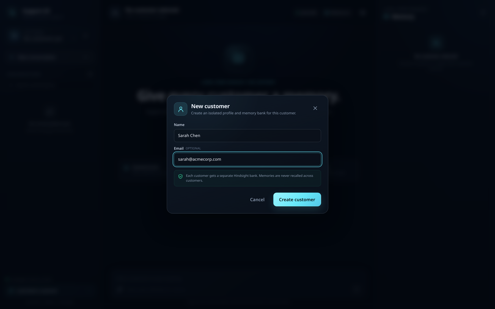
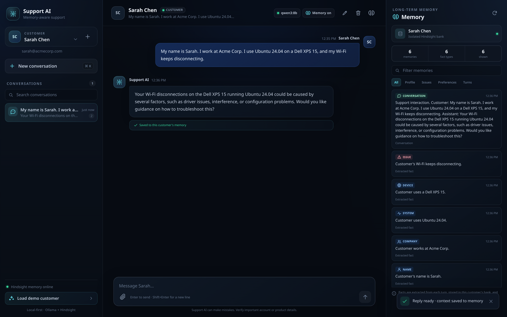
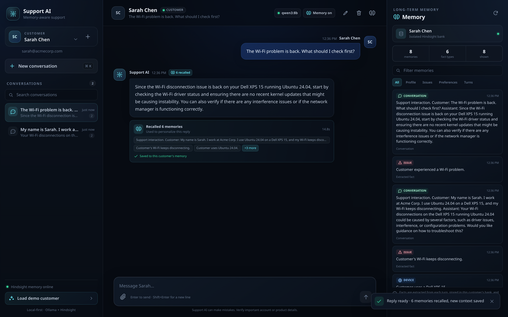
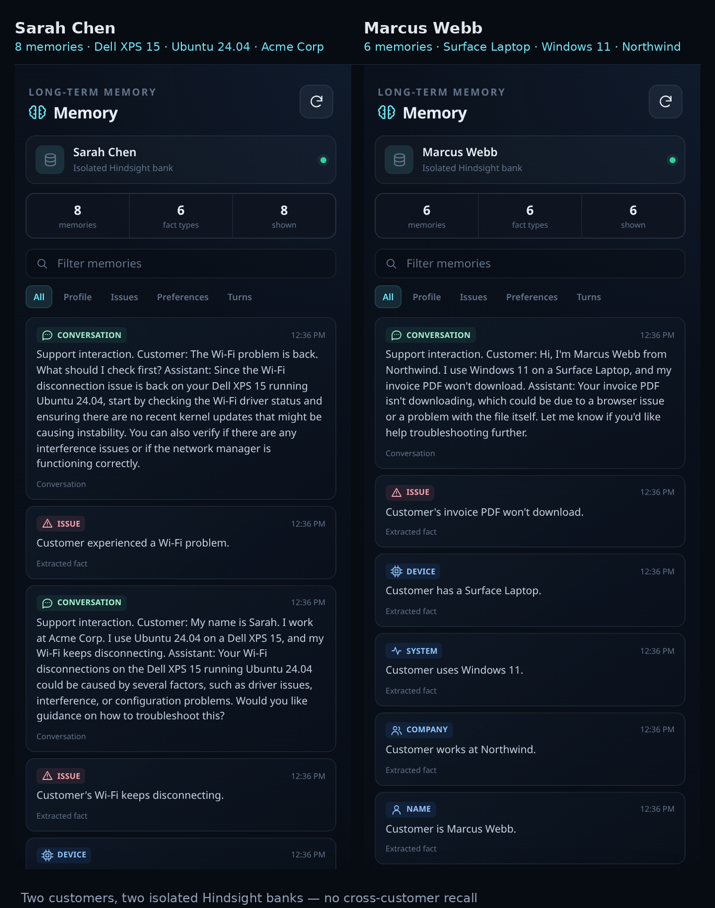
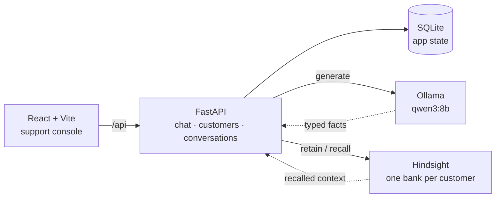

# Support AI

A customer support agent with durable, per-customer long-term memory.

Support AI combines a React console, a FastAPI backend, SQLite, local Ollama
inference, and [Hindsight](https://github.com/vectorize-io/hindsight) as the
memory layer. A customer can explain their setup once, start a new
conversation later, and still get an answer that reflects the earlier context.

## Demo

A 14-second tour of the flows that define the project: customer creation, the
first conversation, fact extraction, returning-customer recall, and memory
isolation between two customers.


1. **Create a customer.** Sarah Chen gets her own profile and memory key.
2. **First conversation.** She describes her Dell XPS 15, Ubuntu 24.04, and a
   recurring Wi-Fi issue.
3. **Fact extraction.** Qwen3 turns the message into six typed facts, visible
   in the memory inspector.
4. **Returning customer.** A new conversation opens with "The Wi-Fi problem is
   back"; six memories are recalled and the reply names her device and OS.
5. **Isolation.** Marcus Webb's bank contains only his Windows/Surface facts —
   none of Sarah's context crosses over.

The full recording is [here](docs/demo/demo.mp4); the motion-graphic overview is
[here](docs/demo/customer-support-agent-demo.mp4).

<details>
<summary><strong>Step-by-step screenshots</strong></summary>

| | |
|:--:|:--:|
|  |  |
| **1. Registration** — isolated bank created up front | **2–3. Conversation + extraction** — reply and six facts |
|  |  |
| **4. Recall** — 6 memories, 14.8 s, device named | **5. Isolation** — Sarah's and Marcus's banks side by side |

</details>

## What it does

- **Remembers customers across conversations.** Durable facts such as name,
  company, device, operating system, recurring issues, and response
  preferences are extracted with Qwen3 and stored in Hindsight.
- **Keeps memory scoped.** Every customer gets a random memory key and a
  dedicated Hindsight bank. Recall cannot leak between customers.
- **Shows its work.** The console includes a memory inspector, recalled
  memories per turn, latency, model, and service health.
- **Supports attachments.** Text, Markdown, CSV, JSON, and PDF files are
  parsed and included in the model context; images are attached and described
  without pretending to read their pixels.
- **Manages the full lifecycle.** Create, rename, and delete customers and
  conversations; clear a customer's memory; deleting a customer also deletes
  their Hindsight bank.
- **Answers quickly.** Independent work is overlapped, Hindsight is prepared
  while the model generates, and the UI renders the reply optimistically.

## Architecture



<details>
<summary>Plain-text architecture</summary>

```text
React console ──▶ FastAPI ──┬──▶ SQLite            app state
                            ├──▶ Ollama qwen3:8b   generation
                            └──▶ Hindsight         one bank per customer
```

</details>

The backend extracts facts with Ollama, stores those exact facts in Hindsight
(`retain_extraction_mode="chunks"`, observations disabled), and uses Hindsight
for semantic recall. SQLite remains the source of truth for application data;
Hindsight is the source of truth for long-term customer context.

## Quick start with Docker

Requirements: Docker with Compose, about 8 GB of free disk for the models, and
a machine that can run an 8B model.

```bash
git clone https://github.com/charansaiteja-cloud/AI-AGENT.git
cd AI-AGENT
docker compose up --build -d
```

The `models` service pulls `qwen3:8b` and `qwen2.5-coder:3b` on first start.
Once it finishes, open <http://localhost:8000>. API docs are at
<http://localhost:8000/docs>.

```bash
docker compose logs -f app      # application logs
docker compose down             # stop, keep data
docker compose down -v          # stop and delete all data
```

## Local development

Requirements:

- Python 3.12+
- Node.js 22+
- [Ollama](https://ollama.com/) with `qwen3:8b`
- [Hindsight](https://hindsight.vectorize.io/) on port `8888`

### 1. Start Ollama and Hindsight

```bash
ollama pull qwen3:8b
ollama pull qwen2.5-coder:3b

docker compose up -d ollama hindsight
```

Hindsight uses `qwen2.5-coder:3b` for its own extraction work and stores its
Postgres data in the `hindsight-data` volume. The application's own fact
selection uses `qwen3:8b` through Ollama.

### 2. Install and run the backend

```bash
python3 -m venv .venv
source .venv/bin/activate
pip install -r backend/requirements-dev.txt
cp .env.example .env
uvicorn backend.app.main:app --reload --port 8000
```

The database and upload directory are created on startup.

### 3. Install and run the frontend

In a second terminal:

```bash
cd frontend
npm ci
npm run dev
```

Open <http://localhost:5173>. Vite proxies `/api` to the backend on port
`8000`.

### 4. Try the memory demo

1. Create a customer, or use the seeded demo customer from the welcome screen.
2. Send: *"My name is Sarah. I work at Acme Corp. I use Ubuntu 24.04 on a Dell
   XPS 15, and my Wi-Fi keeps disconnecting."*
3. Wait for **context saved to memory**.
4. Start a new conversation and send: *"The Wi-Fi problem is back."*
5. The reply should mention the earlier device or operating system, and the
   memory panel should show the recalled facts.

## Configuration

Copy `.env.example` to `.env` and adjust as needed. The most important values:

| Variable | Default | Purpose |
| --- | --- | --- |
| `OLLAMA_BASE_URL` | `http://localhost:11434` | Ollama endpoint |
| `OLLAMA_MODEL` | `qwen3:8b` | Chat and fact-extraction model |
| `OLLAMA_HISTORY_MESSAGES` | `20` | Recent messages sent as conversation history |
| `HINDSIGHT_BASE_URL` | `http://127.0.0.1:8888` | Hindsight API |
| `HINDSIGHT_ENABLED` | `true` | Set to `false` to run without long-term memory |
| `HINDSIGHT_RECALL_LIMIT` | `8` | Maximum recalled memories per turn |
| `DATABASE_URL` | `sqlite+aiosqlite:///.../data/support_agent.db` | Application database |
| `UPLOAD_DIR` | `data/uploads` | Attachment storage |
| `MAX_UPLOAD_SIZE` | `10485760` | Upload limit in bytes |
| `RATE_LIMIT_CHAT_PER_MINUTE` | `60` | Per-IP chat limit |
| `APP_API_KEY` | unset | Optional shared secret for every `/api` route |
| `VITE_API_KEY` | unset | Build-time key sent by the bundled frontend |

Production values should use absolute paths and a real database. See
[SECURITY.md](SECURITY.md) before exposing the app.

### Optional API-key authentication

The demo is open by default so `docker compose up` works without extra setup.
Set `APP_API_KEY` to a long random value to require `X-API-Key` on every API
route except the health probes:

```bash
export APP_API_KEY="$(python -c 'import secrets; print(secrets.token_urlsafe(32))')"
uvicorn backend.app.main:app --port 8000
curl -H "X-API-Key: $APP_API_KEY" http://localhost:8000/api/customers
```

The comparison uses `secrets.compare_digest`. If you serve the bundled
frontend, build it with the same value in `VITE_API_KEY`; for an internet-facing
deployment, put the app behind TLS and a real identity-aware proxy. A shared
key is a deployment guard, not a multi-tenant authorization model.

## API

Interactive documentation: <http://localhost:8000/docs>.

| Method | Path | Description |
| --- | --- | --- |
| `POST` | `/api/chat` | Send a message, recall memory, generate a reply, retain the turn |
| `GET` | `/api/health` | Database, Ollama, and Hindsight status |
| `GET` | `/api/health/live` | Liveness probe |
| `GET` | `/api/health/ready` | Readiness probe |
| `GET` | `/api/models` | Models reported by Ollama |
| `GET/POST` | `/api/customers` | List or create customers |
| `GET/PATCH/DELETE` | `/api/customers/{id}` | Customer lifecycle |
| `GET/POST` | `/api/customers/{id}/conversations` | List or create conversations |
| `GET/POST` | `/api/customers/{id}/memories` | Inspect or clear a customer's memory |
| `GET/PATCH/DELETE` | `/api/conversations/{id}` | Conversation lifecycle |
| `GET` | `/api/conversations/{id}/messages` | Message history |
| `GET/POST` | `/api/conversations/{id}/attachments` | List or upload attachments |
| `GET/DELETE` | `/api/attachments/{id}` | Download or delete an attachment |
| `POST` | `/api/demo/seed` | Create or return the demo customer |
| `GET` | `/api/demo/scenario` | Demo script used by the welcome screen |

A chat response includes the reply, conversation and message IDs, recalled
memories, `memory_used`, `memory_saved`, and `latency_ms`.

## Memory design

- **One bank per customer.** A customer's `memory_key` is a random UUID hex
  generated at creation. The bank name is `support-customer-<memory_key>`.
- **Explicit fact selection.** `MemoryExtractor` asks Ollama for a small JSON
  list of durable facts, validates kinds, removes duplicates, and caps each
  fact at 240 characters.
- **Deterministic storage.** Hindsight runs with `retain_extraction_mode`
  set to `chunks` and observations disabled, so the facts selected by the
  application are the facts stored.
- **Hybrid recall.** Each turn runs two Hindsight queries in parallel: one for
  the current request and one for preferences and recurring context. Results
  are deduplicated and capped.
- **Turn summaries.** The user/assistant exchange is also retained as a short
  summary, preserving the human context around the extracted facts.
- **Privacy by deletion.** Clearing memory deletes the whole bank. Deleting a
  customer is refused if their bank cannot be erased.

## Latency

The Send → reply path avoids serial work wherever possible:

- history loading, semantic recall, attachment parsing, fact extraction, and
  Hindsight bank preparation run concurrently;
- bank creation and duplicate-fact lookup are completed while Qwen3 generates;
- the user message is written once, after generation, without redundant
  refreshes;
- the frontend renders the user message immediately and appends the assistant
  reply as soon as the API responds, refreshing the sidebar, memory panel, and
  health in the background.

## Memory-extraction evaluation

The product claim is that the agent retains durable customer facts. The
repository includes a small, labelled evaluation harness so that claim can be
measured instead of asserted:

```bash
python -m backend.eval.memory_eval --backend fixture   # offline, used in CI
python -m backend.eval.memory_eval --backend ollama --model qwen3:8b
```

`fixture` checks the scorer and dataset plumbing without a model. `ollama`
runs the real `MemoryExtractor` against eight labelled messages and reports
keyword recall, fact precision, F1, duplicates, and invalid fact kinds. The
process exits non-zero when recall or precision falls below the configured
thresholds. See [docs/EVALUATION.md](docs/EVALUATION.md) for the metric
definitions and limitations.

## Testing and quality

```bash
pytest                      # 121 backend tests, 84.9% branch coverage, 83% gate
ruff check backend
ruff format --check backend
mypy backend/app
python -m backend.eval.memory_eval --backend fixture
cd frontend && npm test     # 17 component and utility tests
cd frontend && npm run lint
cd frontend && npm run build
```

Backend tests use an isolated in-memory SQLite database, fake Ollama and
Hindsight services, and `respx` for the real HTTP adapters. Frontend tests use
Vitest, Testing Library, and jsdom. GitHub Actions runs backend lint, type
checks, the offline evaluation, tests, frontend lint/tests/build, and a
production container build.

## Project structure

```text
backend/
  app/
    api/routes/        chat, customers, conversations, health, demo
    db/                async SQLAlchemy engine and session
    models/            Customer, Conversation, Message, Attachment
    schemas/           Pydantic request/response models
    services/          Ollama, Hindsight, fact extraction, attachments
  eval/               labelled memory-extraction evaluation and CLI
  tests/               API and service tests
frontend/
  src/
    components/        three-pane support console
    api.js             fetch wrapper and error handling
    App.jsx            state orchestration and optimistic send flow
docs/demo/             demo video
.github/workflows/     CI
Dockerfile             multi-stage production image
docker-compose.yml     app + Ollama + Hindsight
```

## Limitations

- No authentication or per-user authorization; this is a local demo, not a
  multi-tenant SaaS.
- SQLite and in-process rate limiting are intended for a single instance.
- Image attachments are stored and referenced, but no OCR or vision model is
  used.
- Memory quality depends on the local model's fact extraction. The extractor
  is deliberately conservative and only stores explicit, durable facts.

## License

[MIT](LICENSE)
